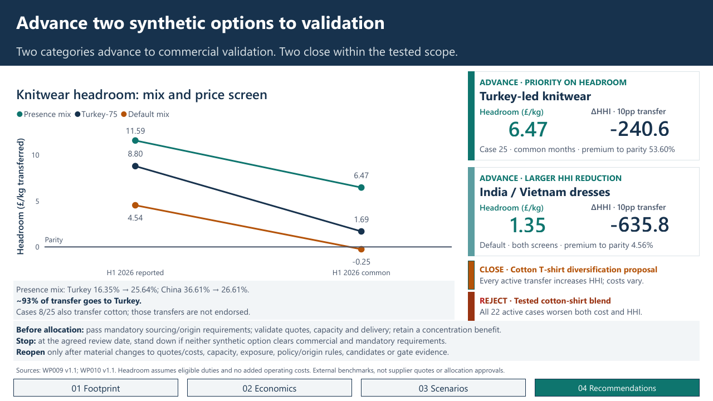
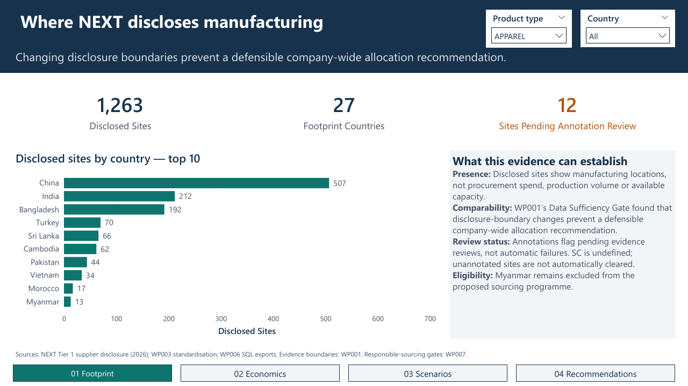
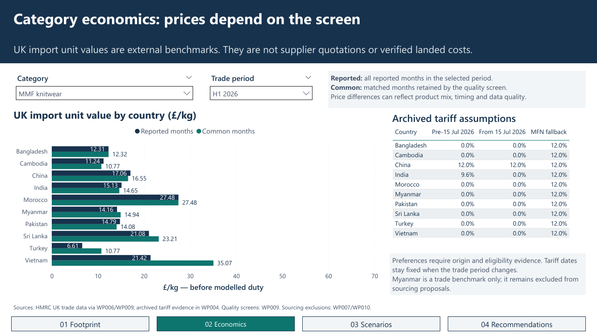
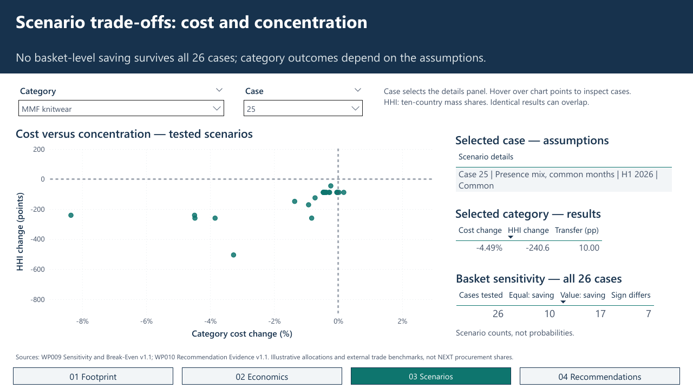

# NEXT Apparel Sourcing Resilience

**Advance Turkey-led MMF knitwear and India/Vietnam synthetic-dress options to commercial validation. Close the tested cotton T-shirt diversification proposal and reject the tested cotton-shirt blend. No general basket saving survives all 26 scenarios.**

Independent portfolio project using published data. PostgreSQL prepares the evidence, Excel models the sourcing scenarios, and Power BI presents the validated results. These are external trade benchmarks and illustrative allocations, not NEXT procurement instructions.

[View the four-page report](power-bi/NEXT_Apparel_Sourcing_Resilience_Report.pdf) · [Explore the Power BI file](power-bi/NEXT_Apparel_Sourcing_Resilience.pbix) · [Browse the file guide](FILE_GUIDE.md)

## Business question and evidence boundary

> Should NEXT rebalance its disclosed sourcing footprint following the 2026 changes in relative UK trade treatment-and, for the selected apparel category, which country alternatives are most attractive, by how much, and under what conditions?

The original question and analytical decisions are recorded in [Research question and scope](docs/Research_Question_and_Scope.md), with linked [reporting-boundary evidence](docs/governance/Reporting_Boundaries.md).

**WP001's Data Sufficiency Gate found that disclosure-boundary changes and missing apparel procurement values prevent a defensible company-wide allocation recommendation from public data.** The disclosed 73% top-three figure mixes brand and supplier-tier boundaries. The project therefore distinguishes NEXT's disclosed site footprint, UK category trade benchmarks and illustrative scenario allocations. This is an evidenced limitation of the original question.

## Category decisions

| Category | Decision and evidence |
|---|---|
| **MMF knitwear — 61103099** | Advance Turkey-led options. Lead with presence-weighted cases 8/25; compare Turkey-75 cases 11/26. Common-month headroom is **£6.47/kg (53.60%)**, **£1.69/kg (10.04%)** and **−£0.25/kg (−1.33%)** for presence weighting, Turkey-75 and the default mix respectively. |
| **Synthetic dresses — 62044300** | Advance India/Vietnam options. The default transfer reduces HHI by **635.8 points**, with **£1.35/kg (4.56%)** headroom under both price screens. The margin is thin and vulnerable to premiums or tariff changes. |
| **Cotton T-shirts — 61091000** | Close the tested China-transfer proposal as diversification: HHI increases whenever a transfer occurs. Cost outcomes are mixed. |
| **Cotton shirts — 62052000** | Reject the tested blend: all **22 active cases** worsen cost and concentration. Default headroom is **−£3.98/kg**; receiver prices need to fall **14.07%** to reach parity before added costs. |

Presence weighting moves Turkey from **16.35% to 25.64%** and China from **36.61% to 26.61%**. About **93% of the transfer goes to Turkey**: the headroom comes with a concentration trade-off. **Cases 8/25 also transfer cotton; those transfers are not endorsed.**

Equal weighting gives savings in **10/26** cases, value weighting in **17/26**, with sign disagreement in **seven**. These frequencies are not probabilities and neither weighting represents NEXT's actual spend.

**If neither synthetic proposal clears the commercial and mandatory requirements, stand down the proposed programme.** The [report README](power-bi/README.md#conditions-stop-rules-and-reopening) and [final decision document](docs/NEXT_WP010_Decision_Recommendation_v1.1.docx) retain the proceed, stop and material-change reopening rules.

## What the analysis ruled out

| Proposition | Finding |
|---|---|
| A company-wide allocation target from public disclosures | Inconsistent boundaries and unavailable apparel procurement values prevent a defensible baseline. |
| A general basket saving or blanket China-reduction target | Cost signs depend on assumptions and weighting; the tested cotton transfers increase concentration. |
| The tested cotton diversification proposals | Close the T-shirt transfer as diversification; reject the shirt blend on cost and concentration. |
| Immediate implementation of the synthetic proposals | Advance only to commercial validation, with capacity, origin, service and mandatory gates still to clear. |

The **placebo test is a methodological result**, not merely a caveat. India's chapter-growth difference was accompanied by substantial changes in comparison countries without the same treatment. That undermined the causal design, so no tariff effect is claimed from it. The [scope record](docs/Research_Question_and_Scope.md#what-the-failed-causal-design-establishes) gives the figures and source location.

## Explore the evidence

| Purpose | Open |
|---|---|
| Read the business result | [Four-page report PDF](power-bi/NEXT_Apparel_Sourcing_Resilience_Report.pdf) |
| Inspect the interactive model | [PBIX](power-bi/NEXT_Apparel_Sourcing_Resilience.pbix) and [report README](power-bi/README.md) |
| See interactivity | [APPAREL → HOME](power-bi/images/01_Filter_Product_APPAREL_to_HOME.png) and [Case 25 → 26](power-bi/images/02_Filter_Case25_to_Case26.png) |
| Inspect Power Query and DAX | [Power Query](power-bi/technical/Power_Query.md), [22 measures](power-bi/technical/Measures.dax) and [model/methodology](power-bi/technical/Model_and_Methodology.md) |
| Inspect the scenario calculations | [Excel workbooks](excel/README.md), especially WP009 and final WP010 v1.1 |
| Reproduce the SQL evidence base | [SQL overview](sql/README.md), [run guide](sql/RUN_GUIDE.md) and [QC record](sql/QC_SUMMARY.md) |

### Other report pages

**WP means work package:** a named stage of this project. The [file guide](FILE_GUIDE.md) maps the codes used in filenames and citations to their subjects.

## Technical delivery and verification

- **PostgreSQL:** 12 numbered scripts, 14 staging tables, 14 core tables, 11 analytical views and ten CSV exports. A fresh rebuild completed on 16 September 2026; all ten rebuilt exports matched the originals byte-for-byte, with zero World/partner reconciliation discrepancies. The inputs, outputs and saved verification evidence are included.
- **Excel:** seven workbooks covering footprint standardisation, tariff assumptions, monthly trade, responsible-sourcing gates, scenarios, sensitivity and final recommendations. WP009 preserves **26 cases × four categories**.
- **Power BI:** ten Import tables, eleven active single-direction relationships, 22 DAX measures and four visible pages. The 104 embedded scenario/category rows reconcile to WP009 v1.1.

The PBIX includes its data and opens without PostgreSQL or a refresh. To refresh on another computer, first update the source paths using the [refresh instructions](power-bi/technical/Model_and_Methodology.md#refresh-and-export).

## Sources and limitations

Sources include NEXT's February 2026 Tier 1 disclosure and corporate reporting, HMRC UK Trade Info, archived UK Trade Tariff evidence and the documented preference/origin framework. The [source register](docs/governance/Source_Register.md), [source index](power-bi/README.md#sources-and-limitations) and workbook evidence tabs retain citations and snapshot details.

Site counts, UK trade shares and scenario allocations describe different populations. Trade unit values are not supplier quotations, verified capacity or complete implementation costs. Scenario HHI uses the **ten-country mass-share baseline**. The footprint dimension contains 31 countries; benchmark facts cover ten, so countries outside that coverage have missing benchmarks rather than zero values.

Myanmar remains excluded under D008/D020. The 11 “site not audited” and five “can't find on SC” annotations are **Pending evidence reviews**, not automatic failures. SC is undefined; unannotated sites are not automatically cleared.

**WP004's placebo evidence undermined the causal identification strategy. The tariff effect remains unestimated by that design; it was not shown to be zero.** Tariff assumptions are archived analytical snapshots, not a live statement of current treatment.

## Data attribution

Contains public sector information licensed under the [Open Government Licence v3.0](https://www.nationalarchives.gov.uk/doc/open-government-licence/version/3/).

HMRC trade data is sourced from [UK Trade Info](https://www.uktradeinfo.com/) and is subject to Crown copyright. Calculations and scenario results are the project's own analysis and do not imply HMRC endorsement.

NEXT plc disclosures are cited as sources. The repository includes extracted and transformed supplier-site data for analysis; the original NEXT reports are linked rather than included in full. Rights in third-party source material remain with their respective rights holders. The Open Government Licence notice applies to the relevant public sector information, not to the project as a whole.
