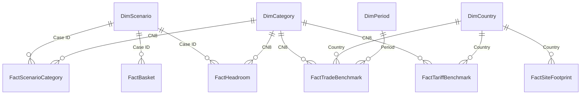

# NEXT Apparel Sourcing Resilience

**Decision:** advance Turkey-led MMF knitwear and India/Vietnam synthetic-dress options to commercial validation. Close the tested cotton T-shirt diversification proposal and reject the tested cotton-shirt blend. No general basket saving survives all 26 scenarios.

Independent portfolio project using published evidence. PostgreSQL prepares the evidence, Excel owns the scenario calculations, and Power BI presents the validated results. This is a public-data options assessment, not a NEXT procurement instruction.

## Business question and scope finding

> Should NEXT rebalance its disclosed sourcing footprint following the 2026 changes in relative UK trade treatment-and, for the selected apparel category, which country alternatives are most attractive, by how much, and under what conditions?

The original question and the scope decision are reproduced in [Research question and scope](../docs/Research_Question_and_Scope.md). [S1]

**WP001's Data Sufficiency Gate found that changes in disclosure boundaries and unavailable apparel procurement values prevent a defensible company-wide allocation recommendation.** The published top-three exposure figure mixes brand and supplier-tier boundaries. The category assessment follows that evidenced limitation; it does not substitute UK trade shares for NEXT's purchasing shares. [S1, S4]

## Recommendation

| Category | Decision within tested scope | Evidence and condition |
|---|---|---|
| MMF knitwear — 61103099 | Advance Turkey-led options; lead with presence-weighted cases 8/25 and compare Turkey-75 cases 11/26 | Common-month headroom: **£6.47/kg (53.60%)** for presence weighting, **£1.69/kg (10.04%)** for Turkey-75 and **−£0.25/kg (−1.33%)** for the default mix. Attractiveness depends on the mix and price assumptions. |
| Synthetic dresses — 62044300 | Advance India/Vietnam options to validation | Default transfer reduces HHI by **635.8 points**, with **£1.35/kg (4.56%)** headroom under both price screens. The margin is thin: a 5% receiver premium removes the modelled saving. |
| Cotton T-shirts — 61091000 | Close the tested China-transfer proposal as diversification | Every active transfer increases HHI. Cost outcomes are mixed; a separate cost proposal would need its own appraisal. |
| Cotton shirts — 62052000 | Reject the tested blend on cost and concentration | All **22 active cases** worsen both. Default headroom is **−£3.98/kg**; receiver prices must fall **14.07%** to reach parity before added costs. |

Presence weighting moves Turkey from **16.35% to 25.64%** and China from **36.61% to 26.61%**. About **93% of the transfer goes to Turkey**. It reduces HHI by 240.6 points but creates a deliberate concentration trade-off. Turkey-75 reduces HHI by 259.7 points at a smaller feasible transfer of 7.06 percentage points. The higher-headroom mix is not a demonstrated optimum. **Cases 8/25 also transfer cotton; those transfers are not endorsed.** [S3, S4]

Equal weighting produces savings in **10/26** cases, value weighting in **17/26**, with sign disagreement in **seven**. These are frequencies across designed cases, not probabilities. Neither weighting represents NEXT's actual spend. [S3]


WP means **work package**, a project stage. See the [file guide](../FILE_GUIDE.md) for the code-to-file mapping.

## Open the report

- [Power BI workbook](NEXT_Apparel_Sourcing_Resilience.pbix) — model, relationships, Power Query, DAX and four report pages.
- [Four-page PDF](NEXT_Apparel_Sourcing_Resilience_Report.pdf) — the default state described below.
- [All DAX expressions](technical/Measures.dax) and [Power Query transformations](technical/Power_Query.md) — searchable technical evidence.

Download and open the `.pbix` in **Power BI Desktop for Windows**. Explore the saved report without refreshing. All ten model tables are in **Import mode** and their data are stored in the file; no PostgreSQL connection is used by the report. Source files are needed only to refresh.

### Default state and page behaviour

| Page | Saved selection | What to inspect |
|---|---|---|
| 01 Footprint | Product type **APPAREL**; Country **All** | 1,263 disclosed sites, 27 countries and 12 pending annotation reviews. Company footprint counts are separate from trade benchmarks. |
| 02 Economics | **MMF knitwear**; **H1 2026** | Reported versus common-month UK import unit values and archived tariff assumptions. The tariff-date columns do not change with the trade-period slicer. |
| 03 Scenarios | **MMF knitwear**; **Case 25** | −4.49% cost change, −240.6 HHI change and 10.00 pp transfer. The scatter shows all 26 cases for the selected category; Case filters the detail panels. Basket counts stay at 26/10/17/7. |
| 04 Recommendations | Fixed category/case comparisons | Knitwear case 25 and dresses case 1 cards; reported/common knitwear comparisons. Chart selections do not filter the recommendation cards. |

In Desktop, Ctrl+click the navigation buttons. Hover over scatter points to inspect scenario details; identical outcomes overlap. A hidden **Model Check** page is retained as technical evidence and excluded from the PDF and normal page navigation.

### Other report pages


### Filter comparisons

One slicer selection changes in each comparison, with the other selections and chart scales held constant.

1. **Product: APPAREL → HOME**, Country All. Cards change from 1,263/27/12 to **215/19/4**. The sites axis remains 0–700. The HOME top-10 cutoff includes ties, so more than ten countries can appear and require scrolling.
2. **Case: 25 → 26**, MMF knitwear. Cost/HHI/transfer change from −4.49%/−240.6/10.00 pp to **−0.83%/−259.7/7.06 pp**. Scatter and basket overview remain unchanged. Changing Case selects a complete saved scenario; it is not a single economic-assumption experiment. The knitwear receiver mix changes and these full cases also differ in their treatment of other categories.

[View the APPAREL → HOME comparison](images/01_Filter_Product_APPAREL_to_HOME.png)

[View the Case 25 → 26 comparison](images/02_Filter_Case25_to_Case26.png)

## Model

Four shared dimensions filter six fact tables. Every relationship is active, one-to-many, with **single-direction filtering from dimension to fact**. There are no fact-to-fact relationships.



### Table grains

| Table | Rows | One row represents | Key |
|---|---:|---|---|
| DimScenario | 26 | A validated scenario and its captured assumptions | Case ID |
| DimCategory | 4 | One CN8 category | CN8 |
| DimCountry | 31 | One country in the disclosed footprint | Country |
| DimPeriod | 3 | FY2025, H1 2025 or H1 2026 | Period |
| FactScenarioCategory | 104 | A saved scenario × category result | Case ID + CN8 |
| FactBasket | 26 | One saved scenario's two basket-weighting results | Case ID |
| FactHeadroom | 11 | One selected case × category headroom comparison | Case ID + CN8 |
| FactSiteFootprint | 1,478 | One official Site ID in the February 2026 Tier 1 disclosure | site_id |
| FactTradeBenchmark | 120 | Period × country × CN8 benchmark; both price screens in the row | Key |
| FactTariffBenchmark | 40 | Country × CN8 with archived rate columns | Key |

`DimCountry[Country]` joins to `FactSiteFootprint[country_standardized]` and to the other two facts' `Country` columns. Other relationship key names match on both sides. `DimCategory` does **not** filter the footprint: broad APPAREL/HOME site classifications do not establish CN8 production capability. `DimPeriod` does not filter tariffs or scenarios: tariff assumptions are date-labelled snapshots, and scenario price periods are already captured in `DimScenario`.

`DimCountry` contains 31 footprint countries, while the trade and tariff facts cover only the ten-country analytical baseline; filtering those facts to any of the other 21 countries returns blank benchmarks because they are outside coverage, not zero-valued observations.

The headroom table is deliberately sparse: 11 selected comparisons, not all 104 scenario/category combinations. A blank headroom value can therefore mean that no comparison was imported; it must not be interpreted as zero.

### Power Query

Power Query imports the existing validated Excel snapshots and the WP006 site CSV. It selects the required blocks, promotes headers, assigns types, appends the headroom comparisons and builds unique country/period dimensions. Five staging/helper queries remain outside the loaded model.

The scenario engine stays in Excel. Fixed row offsets depend on the archived workbook layouts and must be reviewed if those layouts change. [All Power Query expressions](technical/Power_Query.md) · [Detailed design choices](technical/Model_and_Methodology.md#power-query-choices).

## Key DAX

Single-result measures return BLANK for ambiguous selections rather than summing scenario outcomes. Unit values divide total value by total mass. Basket measures count designed cases, not probabilities.

<details>
<summary>Show six key measures</summary>

```dax
Scenario Category Rows =
COUNTROWS ( FactScenarioCategory )
```

```dax
Category Cost Change % =
IF (
    [Scenario Category Rows] = 1,
    SELECTEDVALUE ( FactScenarioCategory[Cost change] ),
    BLANK ()
)
```

```dax
Category HHI Change =
IF (
    [Scenario Category Rows] = 1,
    SELECTEDVALUE ( FactScenarioCategory[HHI change] ),
    BLANK ()
)
```

```dax
Headroom GBP per kg =
IF (
    HASONEVALUE ( DimScenario[Case ID] )
        && HASONEVALUE ( DimCategory[CN8] )
        && COUNTROWS ( FactHeadroom ) = 1,
    SELECTEDVALUE ( FactHeadroom[Headroom GBP/kg] ),
    BLANK ()
)
```

```dax
Reported Unit Value GBP per kg =
IF (
    HASONEVALUE ( DimPeriod[Period] )
        && HASONEVALUE ( DimCategory[CN8] ),
    DIVIDE (
        SUM ( FactTradeBenchmark[Reported value £] ),
        SUM ( FactTradeBenchmark[Reported mass kg] )
    ),
    BLANK ()
)
```

```dax
Basket Sign Disagreement Cases =
COALESCE (
    COUNTROWS (
        FILTER (
            FactBasket,
            FactBasket[Equal-weight cost change]
                * FactBasket[Value-weight cost change] < 0
        )
    ),
    0
)
```

</details>

[All 22 measures](technical/Measures.dax) · [Measure definitions and interpretation](technical/Model_and_Methodology.md#measures-and-interpretation).

## Conditions, stop rules and reopening

Commercial validation must establish matching product specifications and volumes, comparable quotes, available capacity, service and quality terms, manufacturing origin and all applicable responsible-sourcing requirements. A controlled trial needs agreed acceptance criteria, a combined downside case, an evidenced budget and a review date. The analysis grants no supplier or allocation approval. [S4, S5]

At the agreed review date, close the proposed reallocation when no acceptable case remains under these WP010 stop conditions:

| Rule | Stop condition |
|---|---|
| ST01 | No candidate meets mandatory requirements within the evidence window and no further candidate is identified. |
| ST02 | Comparable actual costs fail the agreed combined downside, without a separately evidenced and approved resilience case justifying the extra cost. |
| ST03 | Verified available capacity cannot meet the worthwhile trial or allocation objective agreed before evaluation. |
| ST04 | The intended concentration benefit disappears under actual procurement weights, or a material shared dependency remains. |

**If neither synthetic proposal clears the commercial and mandatory requirements, stand down the proposed programme.** Closure does not establish that incumbent sourcing is optimal or compliant. Reopen only for specified material changes in candidates, comparable quotes/costs, capacity, exposure, policy, authoritative origin rules or gate evidence. Retain the detailed WP010 `Implementation` triggers for quality, delivery, worker and evidence changes. [S4]

Myanmar remains excluded under **D008/D020**. The **11 “site not audited”** and **five “can't find on SC”** annotations are Pending evidence reviews, not automatic failures. **SC is undefined** and unannotated sites are not automatically cleared. Confirmed mandatory failure excludes new allocation; unresolved Pending or Conditional preconditions prevent clearance. [S5]

## Sources and limitations

| ID | Evidence | Role |
|---|---|---|
| S1 | [Research question and scope](../docs/Research_Question_and_Scope.md); [reporting-boundary evidence](../docs/governance/Reporting_Boundaries.md); decisions D010/D023 | Original question and disclosure-boundary finding. |
| S2 | [NEXT February 2026 Tier 1 supplier disclosure](https://www.nextplc.co.uk/~/media/Files/N/next-plc-v4/Tier%201%20-2%20-%203%20lists/PLC%20LIST%20FEB%202026%20-%20TIER1.pdf); WP003 standardisation; WP006 `NEXT_WP006_site_supplier_overlap.csv` | Site-level footprint and evidence-review flags. |
| S3 | WP009 `NEXT_WP009_Sensitivity_and_Break_Even_v1.1.xlsx`: `Sensitivity`, `Source_Data`, `Monthly_Data`, `Break_Even`, `QC_Checks` | Saved scenarios, external trade benchmarks, thresholds and source locators. Trade observations derive from [HMRC UK Trade Info](https://www.uktradeinfo.com/) through WP005/WP006. |
| S4 | WP010 `NEXT_WP010_Recommendation_Evidence_v1.1.xlsx`: `Category_Decisions`, `Implementation`, `Evidence`; companion Decision Recommendation v1.1 | Final category decisions, headroom, proceed/stop/reopen conditions and source fingerprints. |
| S5 | WP007 Responsible Sourcing Gates v1.0: `Gate_Matrix`, `Site_Review`, `Evidence` | Mandatory requirements, Pending status and Myanmar restriction. |
| S6 | WP004 Category Tariff Lock: `Tariff_Matrix`, `Origin_Rules`, `Natural_Experiment`; archived [UK Trade Tariff](https://www.trade-tariff.service.gov.uk/) evidence | Rate assumptions and the unsuccessful chapter-level causal design. |
| S7 | [DCTS preference tiers](https://www.gov.uk/guidance/preference-tiers-under-the-developing-countries-trading-scheme); [UK–India CETA Annex 2A](https://assets.publishing.service.gov.uk/media/687f692d92957f2ec567c6ad/uk_india_ceta_annex2a_schedules_tariff_commitments_for_goods.pdf); [Annex 3A](https://assets.publishing.service.gov.uk/media/687e5e378adf4250705c96db/uk_india_ceta_annex3a_product_specific_rules_of_origin.pdf) | Archived preference-transition and conditional tariff/origin framework. Apply official evidence to the actual product chain before implementation. |

**The report retains archived analytical assumptions. It is not a live tariff lookup.** Tariff dates displayed on Page 2 are the WP004/WP009 snapshot, not a claim that the rates have been refreshed at publication.

Company site counts, UK import shares and scenario allocations describe different populations. UK import unit values are external trade benchmarks, not NEXT procurement shares, supplier quotations, verified capacity or full landed costs. HMRC partner geography records dispatch rather than proven manufacturing origin. Price differences may reflect product/quality mix, seasonality and transaction characteristics. Common-month screening changes the observation set and is not inherently conservative.

The 35% recipient ceiling, 10 pp maximum addition and 3× baseline cap are illustrative scenario constraints, not measured capacity. The 26 cases are not exhaustive optimisation, a probability sample or a complete joint stress test. Lower country HHI does not establish independent upstream supply or better delivery. Other donor proposals and untested receiver countries remain outside the decision scope. Avoid double-counting international freight already contained in border unit values.

**WP004's placebo evidence undermined the causal identification strategy. The tariff effect remains unestimated by that design; it was not shown to be zero.** Trade observations end in June 2026, before the later policy date used in the archived CETA scenario. They cannot demonstrate post-CETA behaviour. [S4, S6]

## Refresh and technical reference

**No refresh is needed to explore the saved PBIX.** To refresh, use the archived [WP009](../excel/NEXT_WP009_Sensitivity_and_Break_Even_v1.1.xlsx) and [WP010](../excel/NEXT_WP010_Recommendation_Evidence_v1.1.xlsx) workbooks in `../excel/` plus `NEXT_WP006_site_supplier_overlap.csv` (included in `inputs/`). In Power Query, use **Data source settings → Change Source** to point the three file sources to their local locations, then **Close & Apply**. Refresh imports saved results; it does not run the Excel scenario engine.

The checked PDF records the default selections listed above. The four default-page PNGs are **1280 × 720** pixels each; the two before/after comparison figures are **1280 × 1650** pixels each. The [technical reference](technical/Model_and_Methodology.md#refresh-and-export) contains detailed refresh instructions and the Desktop PDF-export workaround.

**Validation:** 104 embedded scenario/category rows reconcile to WP009 v1.1; all ten tables use Import mode; the two filter comparisons and four-page PDF have been checked. Model definitions and data were read directly from the final PBIX without PostgreSQL access. [Full verification record](technical/Model_and_Methodology.md#verification-record).
