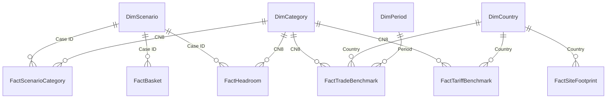

# Model and methodology reference

[Return to the portfolio overview](../README.md). Detailed transformations, measures, decision rules, sources and refresh guidance.

## Model structure

Four shared dimensions filter six fact tables. Every relationship is active, one-to-many, with **single-direction filtering from dimension to fact**. There are no fact-to-fact relationships.



### Table grains

| Table | Rows | One row represents | Key |
|---|---:|---|---|
| DimScenario | 26 | A validated scenario and its captured assumptions | Case ID |
| DimCategory | 4 | One CN8 category | CN8 |
| DimCountry | 31 | One country in the disclosed footprint | Country |
| DimPeriod | 3 | FY2025, H1 2025 or H1 2026 | Period |
| FactScenarioCategory | 104 | A saved scenario × category result | Case ID + CN8 |
| FactBasket | 26 | One saved scenario's two basket-weighting results | Case ID |
| FactHeadroom | 11 | One selected case × category headroom comparison | Case ID + CN8 |
| FactSiteFootprint | 1,478 | One official Site ID in the February 2026 Tier 1 disclosure | site_id |
| FactTradeBenchmark | 120 | Period × country × CN8 benchmark; both price screens in the row | Key |
| FactTariffBenchmark | 40 | Country × CN8 with archived rate columns | Key |

`DimCountry[Country]` joins to `FactSiteFootprint[country_standardized]` and to the other two facts' `Country` columns. Other relationship key names match on both sides. `DimCategory` does **not** filter the footprint: broad APPAREL/HOME site classifications do not establish CN8 production capability. `DimPeriod` does not filter tariffs or scenarios: tariff assumptions are date-labelled snapshots, and scenario price periods are already captured in `DimScenario`.

`DimCountry` contains 31 footprint countries, while the trade and tariff facts cover only the ten-country analytical baseline; filtering those facts to any of the other 21 countries returns blank benchmarks because they are outside coverage, not zero-valued observations.

The headroom table is deliberately sparse: 11 selected comparisons, not all 104 scenario/category combinations. A blank headroom value can therefore mean that no comparison was imported; it must not be interpreted as zero.

### Power Query choices

The Excel scenario engine remains authoritative. Power Query imports its validated snapshots; it does not recalculate or extend the 26 cases.

| Transformation | Purpose |
|---|---|
| Three workbook staging queries | Read WP009 `Sensitivity` and `Source_Data`, plus WP010 `Category_Decisions`, without loading those worksheet-shaped staging tables into the model. |
| Select the fixed row blocks, select columns, promote headers and assign types | Convert the locked workbook layouts into fact and dimension tables. Case IDs are integers; measures remain numeric. |
| Rename source ID/Product fields | Give the model consistent Case ID and Category names. |
| Append nine headroom comparisons and two default cotton comparisons | Preserve the selected WP010 thresholds in an 11-row fact with explicit case/category keys. |
| Import the WP006 site CSV | Use one row per Site ID rather than repeating sites across supplier relationships. |
| Select/distinct country and period columns | Build unique dimension keys from the loaded source populations. |

Fixed row offsets are appropriate for these frozen v1.1 workbooks but are a maintenance limitation: inserting rows or changing layouts requires updating the query steps. CN8 is an identifier. The final model uses text CN8 in most tables and a numeric CN8 in `FactTradeBenchmark`; all four locked eight-digit codes reconcile across the existing relationships. Extending the category set requires reviewing identifier types and joins.

The full 15 query expressions, including the five non-loaded staging/helper queries, are in [Power_Query.md](Power_Query.md). The source-path placeholders in that document do not change the paths saved in the PBIX.

## Measures and interpretation

- **Category cost change:** change in the category benchmark index, not the saving on a supplier quote or NEXT's purchasing budget.
- **Headroom £/kg:** China duty-paid benchmark minus the weighted receiver duty-paid benchmark per kilogram transferred. It is different from category-level cost change.
- **Premium to parity:** headroom divided by the receiver benchmark, holding other costs constant. Negative headroom requires a price reduction; different cost allowances cannot be added together because they consume the same headroom.
- **HHI:** sum of squared country mass shares × 10,000 within the ten-country baseline. A negative change means less concentration in that population; it does not quantify avoided disruption losses.
- **Transfer pp:** feasible fraction × 100. A 0.10 fraction displays as 10.00 percentage points.
- **Unit value:** total import value divided by total mass, rather than an unweighted average of country unit values.

Single-result measures return BLANK when the context contains more than one row, preventing meaningless sums or averages across scenarios. The Page 3 basket overview relies on disabled slicer interactions; the measures themselves remain responsive to filter context. The Page 4 line uses three measures because its price-basis axis filters `FactHeadroom` directly and each line must select a specific case pair.

### Key DAX from the saved model

```dax
Scenario Category Rows =
COUNTROWS ( FactScenarioCategory )
```

```dax
Category Cost Change % =
IF (
    [Scenario Category Rows] = 1,
    SELECTEDVALUE ( FactScenarioCategory[Cost change] ),
    BLANK ()
)
```

```dax
Category HHI Change =
IF (
    [Scenario Category Rows] = 1,
    SELECTEDVALUE ( FactScenarioCategory[HHI change] ),
    BLANK ()
)
```

```dax
Category Transfer pp =
IF (
    [Scenario Category Rows] = 1,
    100 * SELECTEDVALUE ( FactScenarioCategory[Feasible shift] ),
    BLANK ()
)
```

```dax
Headroom GBP per kg =
IF (
    HASONEVALUE ( DimScenario[Case ID] )
        && HASONEVALUE ( DimCategory[CN8] )
        && COUNTROWS ( FactHeadroom ) = 1,
    SELECTEDVALUE ( FactHeadroom[Headroom GBP/kg] ),
    BLANK ()
)
```

```dax
Receiver Premium to Parity % =
IF (
    HASONEVALUE ( DimScenario[Case ID] )
        && HASONEVALUE ( DimCategory[CN8] )
        && COUNTROWS ( FactHeadroom ) = 1,
    SELECTEDVALUE ( FactHeadroom[Max premium] ),
    BLANK ()
)
```

```dax
Reported Unit Value GBP per kg =
IF (
    HASONEVALUE ( DimPeriod[Period] )
        && HASONEVALUE ( DimCategory[CN8] ),
    DIVIDE (
        SUM ( FactTradeBenchmark[Reported value £] ),
        SUM ( FactTradeBenchmark[Reported mass kg] )
    ),
    BLANK ()
)
```

```dax
Common-Month Unit Value GBP per kg =
IF (
    HASONEVALUE ( DimPeriod[Period] )
        && HASONEVALUE ( DimCategory[CN8] ),
    DIVIDE (
        SUM ( FactTradeBenchmark[Common value £] ),
        SUM ( FactTradeBenchmark[Common mass kg] )
    ),
    BLANK ()
)
```

```dax
Disclosed Sites =
COALESCE (
    DISTINCTCOUNT ( FactSiteFootprint[site_id] ),
    0
)
```

```dax
Sites Pending Annotation Review =
COALESCE (
    COUNTROWS (
        FILTER (
            FactSiteFootprint,
            FactSiteFootprint[responsible_sourcing_review_flag] = 1
        )
    ),
    0
)
```

```dax
Basket Saving Cases Equal =
COALESCE (
    COUNTROWS (
        FILTER (
            FactBasket,
            FactBasket[Equal-weight cost change] < 0
        )
    ),
    0
)
```

```dax
Basket Saving Cases Value =
COALESCE (
    COUNTROWS (
        FILTER (
            FactBasket,
            FactBasket[Value-weight cost change] < 0
        )
    ),
    0
)
```

```dax
Basket Sign Disagreement Cases =
COALESCE (
    COUNTROWS (
        FILTER (
            FactBasket,
            FactBasket[Equal-weight cost change]
                * FactBasket[Value-weight cost change] < 0
        )
    ),
    0
)
```

```dax
Knitwear Headroom Presence =
CALCULATE (
    SELECTEDVALUE ( FactHeadroom[Headroom GBP/kg] ),
    FactHeadroom[CN8] = "61103099",
    FactHeadroom[Case ID] IN { 8, 25 }
)
```

```dax
Knitwear Headroom Turkey75 =
CALCULATE (
    SELECTEDVALUE ( FactHeadroom[Headroom GBP/kg] ),
    FactHeadroom[CN8] = "61103099",
    FactHeadroom[Case ID] IN { 11, 26 }
)
```

```dax
Knitwear Headroom Default =
CALCULATE (
    SELECTEDVALUE ( FactHeadroom[Headroom GBP/kg] ),
    FactHeadroom[CN8] = "61103099",
    FactHeadroom[Case ID] IN { 1, 16 }
)
```

The [complete DAX file](Measures.dax) contains all 22 measures, including selection labels, country counts and the guarded basket cost measures.


## Conditions, stop rules and reopening

Commercial validation must establish matching product specifications and volumes, comparable quotes, available capacity, service and quality terms, manufacturing origin and all applicable responsible-sourcing requirements. A controlled trial needs agreed acceptance criteria, a combined downside case, an evidenced budget and a review date. The analysis grants no supplier or allocation approval. [S4, S5]

At the agreed review date, close the proposed reallocation when no acceptable case remains under these WP010 stop conditions:

| Rule | Stop condition |
|---|---|
| ST01 | No candidate meets mandatory requirements within the evidence window and no further candidate is identified. |
| ST02 | Comparable actual costs fail the agreed combined downside, without a separately evidenced and approved resilience case justifying the extra cost. |
| ST03 | Verified available capacity cannot meet the worthwhile trial or allocation objective agreed before evaluation. |
| ST04 | The intended concentration benefit disappears under actual procurement weights, or a material shared dependency remains. |

**If neither synthetic proposal clears the commercial and mandatory requirements, stand down the proposed programme.** Closure does not establish that incumbent sourcing is optimal or compliant. Reopen only for specified material changes in candidates, comparable quotes/costs, capacity, exposure, policy, authoritative origin rules or gate evidence. Retain the detailed WP010 `Implementation` triggers for quality, delivery, worker and evidence changes. [S4]

Myanmar remains excluded under **D008/D020**. The **11 “site not audited”** and **five “can't find on SC”** annotations are Pending evidence reviews, not automatic failures. **SC is undefined** and unannotated sites are not automatically cleared. Confirmed mandatory failure excludes new allocation; unresolved Pending or Conditional preconditions prevent clearance. [S5]

## Sources and limitations

| ID | Evidence | Role |
|---|---|---|
| S1 | [Research question and scope](../../docs/Research_Question_and_Scope.md); [reporting-boundary evidence](../../docs/governance/Reporting_Boundaries.md); decisions D010/D023 | Original question and disclosure-boundary finding. |
| S2 | [NEXT February 2026 Tier 1 supplier disclosure](https://www.nextplc.co.uk/~/media/Files/N/next-plc-v4/Tier%201%20-2%20-%203%20lists/PLC%20LIST%20FEB%202026%20-%20TIER1.pdf); WP003 standardisation; WP006 `NEXT_WP006_site_supplier_overlap.csv` | Site-level footprint and evidence-review flags. |
| S3 | WP009 `NEXT_WP009_Sensitivity_and_Break_Even_v1.1.xlsx`: `Sensitivity`, `Source_Data`, `Monthly_Data`, `Break_Even`, `QC_Checks` | Saved scenarios, external trade benchmarks, thresholds and source locators. Trade observations derive from [HMRC UK Trade Info](https://www.uktradeinfo.com/) through WP005/WP006. |
| S4 | WP010 `NEXT_WP010_Recommendation_Evidence_v1.1.xlsx`: `Category_Decisions`, `Implementation`, `Evidence`; companion Decision Recommendation v1.1 | Final category decisions, headroom, proceed/stop/reopen conditions and source fingerprints. |
| S5 | WP007 Responsible Sourcing Gates v1.0: `Gate_Matrix`, `Site_Review`, `Evidence` | Mandatory requirements, Pending status and Myanmar restriction. |
| S6 | WP004 Category Tariff Lock: `Tariff_Matrix`, `Origin_Rules`, `Natural_Experiment`; archived [UK Trade Tariff](https://www.trade-tariff.service.gov.uk/) evidence | Rate assumptions and the unsuccessful chapter-level causal design. |
| S7 | [DCTS preference tiers](https://www.gov.uk/guidance/preference-tiers-under-the-developing-countries-trading-scheme); [UK–India CETA Annex 2A](https://assets.publishing.service.gov.uk/media/687f692d92957f2ec567c6ad/uk_india_ceta_annex2a_schedules_tariff_commitments_for_goods.pdf); [Annex 3A](https://assets.publishing.service.gov.uk/media/687e5e378adf4250705c96db/uk_india_ceta_annex3a_product_specific_rules_of_origin.pdf) | Archived preference-transition and conditional tariff/origin framework. Apply official evidence to the actual product chain before implementation. |

**The report retains archived analytical assumptions. It is not a live tariff lookup.** Tariff dates displayed on Page 2 are the WP004/WP009 snapshot, not a claim that the rates have been refreshed at publication.

Company site counts, UK import shares and scenario allocations describe different populations. UK import unit values are external trade benchmarks, not NEXT procurement shares, supplier quotations, verified capacity or full landed costs. HMRC partner geography records dispatch rather than proven manufacturing origin. Price differences may reflect product/quality mix, seasonality and transaction characteristics. Common-month screening changes the observation set and is not inherently conservative.

The 35% recipient ceiling, 10 pp maximum addition and 3× baseline cap are illustrative scenario constraints, not measured capacity. The 26 cases are not exhaustive optimisation, a probability sample or a complete joint stress test. Lower country HHI does not establish independent upstream supply or better delivery. Other donor proposals and untested receiver countries remain outside the decision scope. Avoid double-counting international freight already contained in border unit values.

**WP004's placebo evidence undermined the causal identification strategy. The tariff effect remains unestimated by that design; it was not shown to be zero.** Trade observations end in June 2026, before the later policy date used in the archived CETA scenario. They cannot demonstrate post-CETA behaviour. [S4, S6]

## Refresh and export

### Refresh only when needed

Opening and filtering the PBIX uses its embedded data. Refresh is optional and needs three archived inputs. The CSV is included in `power-bi/inputs/`; the two analytical Excel workbooks are included in the repository’s `excel/` folder:

1. `NEXT_WP009_Sensitivity_and_Break_Even_v1.1.xlsx`
2. `NEXT_WP010_Recommendation_Evidence_v1.1.xlsx`
3. `NEXT_WP006_site_supplier_overlap.csv`

The PBIX retains absolute paths from the authoring computer. To refresh elsewhere, use **Transform data → Data source settings → Change Source** for the two workbooks and CSV. Alternatively, change only `File.Contents(...)` in the Source step of `stg_WP009_Sensitivity`, `stg_WP009_SourceData`, `stg_WP010_CategoryDecisions` and `FactSiteFootprint`. Then Close & Apply. No PostgreSQL server is required; the CSV is a materialised WP006 output.

Refresh imports saved Excel results; it does not run the Excel scenario engine. If the underlying analytical evidence changes, update and validate the authoritative workbooks first, then refresh the report and reconcile affected outputs. Do not treat this package as an automatic current-data pipeline.

### Export the default report

Restore the default selections in the [README](../README.md#default-state-and-page-behaviour). In this Desktop build, exporting while a visible report page was active sometimes shrank that page. The successful workaround was to select the **hidden Model Check page**, leave it hidden and export through **File → Export → Export to PDF**. Only the four visible report pages should appear. Inspect the exported file before replacing it, then return to 01 Footprint and save the PBIX.

The four default-page PNGs are **1280 × 720** pixels each, rendered from the checked PDF with only the outer PDF margins removed. The two before/after comparison figures are **1280 × 1650** pixels each. They are not unlimited-resolution output. Comparison figures combine the default export with actual filtered Desktop captures and preserve the chart scales. The PDF is static; slicers and hover tooltips require the PBIX.

## Verification record

- Final PBIX inspected on 8 October 2026: ten populated Import tables, eleven active single-direction relationships and twenty-two DAX measures extracted from the saved file.
- All 104 embedded scenario/category rows reconciled to the WP009 v1.1 saved results. Previously completed analytical QC remains the baseline; no new scenarios were introduced.
- Saved selections agree with the PDF default state. Footprint HOME and scenario Case 26 captures demonstrate the two filter changes linked from the README.
- Page 4's saved interaction settings prevent the headroom chart from filtering the four recommendation cards.
- Four PDF pages visually checked after export: consistent sizing, full headroom values, six line labels, thousands separator and readable table content.
- WP006's earlier fresh database rebuild passed; all ten rebuilt exports matched the originals byte-for-byte and World/partner reconciliation returned zero discrepancies.

Model inspection verifies embedded data and definitions. DAX execution and report rendering occur in Power BI Desktop.
